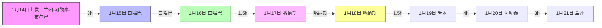

# 2025阿勒泰看雪之旅
一场说走就走的新疆阿勒泰之旅。

# 1. 阿勒泰行程
## 1.1 行程导览

## 1.2 行程总结
1. 没有选择中转乌鲁木齐，乘坐了春秋航空的航班，从兰州直飞阿勒泰，节省了时间。由于出行订的比较仓促，机票还是涨了200左右，除了购买托运行李*2以外，而且没考虑到24寸行李箱无法登机，额外又支付了160的登机行李费用。但直到登机才发现，各种超标的背包手提不管，就管你行李箱。所以返程时候直接把小行李箱打包到了大箱子里。
2. 整体行程非常顺利，没有遇到严重的雪崩封路（离开禾木就听说喀纳斯到禾木雪崩了），也没有遇到堵车情况，仅在禾木进出碰到了较多的车流量。我们采用了与常规线路相反的行程，白哈巴进禾木出。进入白哈巴的路线几乎没什么人。
3. 雪地胎+坦克300比想象中的要好开。全程仅出现了少量的打滑情况。在冰雪路面开启4H模式，加上刚下雪，路面都压实，比较好开。即使驶入相对蓬松的野路，跟着车辙印，都可以比较好的驾驶。
4. 阿勒泰景区的住宿都是民宿，通过联系携程上显示的电话，微信直接与老板订房，一般可以有8.5折左右的优惠。
5. 整体商业化程度白哈巴<<喀纳斯<禾木。冬季的白哈巴可供选择的餐饮就四五家，几乎都是新疆菜。所谓的咖啡店打卡，一共就两家。
6. 查阅了下，虽然禾木的吉克普林滑雪场是亚洲最大，但是几乎都是中级以上坡道，对于新手来说，难度较大。我们选择前往将军山体验滑雪，而且有夜场，外加缆车到山顶可以感受2800米海拔的日落蹦迪，体验不错。
7. 除了滑雪手机冻关机以外，整个行程没有遇到其他突然断电问题，包括无人机。十几二十分钟的户外使用，都还可以正常维持。
8. 三个景区冬季只收取100的三日门票，但只要中间不离开景区，多待几日也无需另外购票。
9. 关于骑马，在白哈巴的骑马有两个选择，前往观景台和丛林漫步，需要单独联系，冬季没有统一运营，夏季有游客中心。喀纳斯有前往观鱼台的集合地，还有喀纳斯湖面骑行。禾木有规范的商业骑马路线和统一购票窗口，有去山顶看日出的，有去丛林的，有拍冰与火之歌凌冬将至的。我们选择了白哈巴的丛林漫步，体验了雪地骑马，下午一直漫步到日落。自由骑行。相比于后两站，更纯正，更宁静。
10. 无人机在阿勒泰属于标配，除了一些自驾，大量游客因为担心雪天路滑，选择的了包车游，都是evike车9坐改装，黑色为主，车还是两驱的。这类比较属于到点打卡游，1200一天，司机几乎人手标配无人机，给你飞一飞。整个行程变成网红打卡。几乎都是套着小红书模板刻出来的。
11. 关于饮食，因为几个村都没有自己的物资生产，所有的都有从最近的哈巴县运输进来，遇到雪天道路不行，可能就会断货。所以冬天的餐饮成本相对夏天会高一些。但是菜的分量还是十分有保障的。我们两个人，一顿饭平均100左右。白哈巴的锅锅肉（198，一大锅羊排），喀纳斯的土火锅（398）、白菜粉条肉（88），禾木的KFC（口味一样，加价20%左右，甚至感觉比机场便宜）。

# 衣物

## 二哈衣物
<EditableTable 
  pageId="trip-2025-01-Aletai" 
  tableId="Sean-Clothes"
  :headers="['物品', '数量', '用途', '图片']"
  :columnConfig="{
    '物品': { 
      type: 'text',
      placeholder: '请输入物品'
    },
    '数量': { 
      type: 'number',
      placeholder: '请输入数量'
    },
    '用途': { 
      type: 'text',
      placeholder: '请输入用途'
    },
    '图片': { 
      type: 'image',
      placeholder: '点击上传图片'
    }
  }"
/>

# 电子产品

<EditableTable 
  pageId="trip-2025-01-Aletai" 
  tableId="Elec-Product"
  :headers="['物品', '数量', '用途', '图片']"
  :columnConfig="{
    '物品': { 
      type: 'text',
      placeholder: '请输入物品'
    },
    '数量': { 
      type: 'number',
      placeholder: '请输入数量'
    },
    '用途': { 
      type: 'text',
      placeholder: '请输入用途'
    },
    '图片': { 
      type: 'image',
      placeholder: '点击上传图片'
    }
  }"
/>

